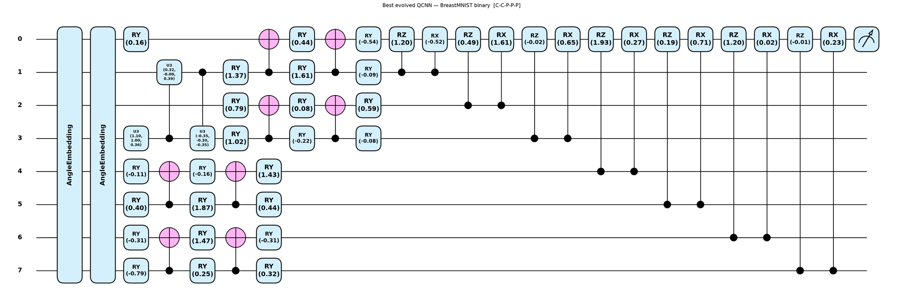

# Evolutionary search for quantum medical-image classifiers

A genetic algorithm that **designs quantum convolutional classifier circuits automatically** for medical-image classification.

Each candidate circuit is a variable-length sequence of [HierarQcal](https://github.com/matt-lourens/hierarqcal) convolution (`Qcycle`) and pooling (`Qmask`) layers. Crossover and mutation breed new architectures, and the fittest ones survive. The circuits are built and trained in [PennyLane](https://pennylane.ai) on 8 qubits. They are tested on four [MedMNIST](https://medmnist.com) datasets.

This code is part of my MSc research at Stellenbosch University and NITheCS, supervised by Prof. Francesco Petruccione and Prof. Ilya Sinayskiy. A write-up is in preparation.

<p align="center">
  
  <br>
  <em>An evolved 8-qubit circuit for BreastMNIST (benign vs malignant). Its layer pattern is convolution–convolution–pooling–pooling–pooling.</em>
</p>

---

## How it works

**1. Encoding.** Each 28 × 28 image is flattened and standardised. It is then compressed with PCA, which is fitted on the training set only, and the components are scaled to [0, π]. The components are angle-encoded onto 8 qubits in one of two ways:

| Variant | PCA components | Encoding |
|---|---|---|
| PCA-8 | 8 | *single*: one `RY` rotation per qubit |
| PCA-16 | 16 | *dense*: `RX` and then `RY` on each qubit, two features per qubit |

**2. Search space.** A genotype is any ordered list of convolution (C) and pooling (P) layers, for example `C-C-P-C-P`.
- Each convolution layer applies a two-qubit gate across the qubits with a sampled stride, step, offset and boundary.
- Each pooling layer discards qubits using a sampled mask pattern.
- Circuits must have between 3 and 10 layers, including at least one convolution, and must leave enough qubits for readout.

**3. Fitness** (lower is better):

```
fitness = Σ_c  w_c · (1 − recall_c)                 # class-weighted recall error
        + L1 · (gate applications / n_qubits)
        + L2 · n_params
        + L3 · n_layers                             # complexity penalties
        + penalty if any class recall < 10 %         # stops "always predict the majority" circuits
```

The class weights `w_c` let clinically costly errors count for more. For example, BreastMNIST weights *malignant* at 0.7.

**4. Evolution.**
- Each step starts by taking the top three circuits. With probability 0.5, the third is swapped for a random lower-ranked circuit to keep the pool diverse.
- Those three produce **6 crossover children**, one for every ordered pair, each made by joining a prefix of one parent to a suffix of the other.
- They also produce **3 mutation children**. Each mutation replaces the tail, inserts a layer, deletes a layer, or swaps one layer.
- Each candidate gets a short training run, and its fitness is scored on the validation set. Candidates are evaluated in parallel with [Ray](https://www.ray.io), and repeated genotypes are cached.

**5. Final training and evaluation.**
- The winning circuit is retrained for 200 epochs on the full, class-balanced training set.
- It is evaluated on a held-out test set (stratified split: 75 % train, 10 % validation, 15 % test).
- Its result is compared with a logistic regression fitted on the same PCA features.

## Datasets

| Dataset | Task | Classes | Readout |
|---|---|---|---|
| BreastMNIST | Breast ultrasound: malignant vs normal/benign | 2 | 1 qubit |
| RetinaMNIST | Diabetic-retinopathy grade (top two grades merged) | 4 | 2 qubits |
| DermaMNIST | Dermatoscopic skin lesions | 7 | 3 qubits |
| BloodMNIST | Blood-cell microscopy | 8 | 3 qubits |

## Installation

```bash
git clone https://github.com/dhiya-d/classifier_ansatz_search.git
cd classifier_ansatz_search
pip install -r requirements.txt
python download_data.py            # downloads MedMNIST and writes <dataset>/*.npy
```

## Running a search

Run every command from the repository root.

```bash
python breastmnist/main.py                     # PCA-8 and PCA-16, one search each
python breastmnist/main.py --variant 8         # PCA-8 only
python breastmnist/main.py --sweep             # every hyperparameter setting in config.py
python breastmnist/main.py --sweep-index 0     # one sweep setting
```

To run another dataset, replace `breastmnist` with `dermamnist`. Each run writes to `experiments/pca8/…` or `experiments/pca16/…`. A run saves:
- the best circuit (`best_circuit.png`, `best_circuit_arch.json`, `best_params.pt`)
- training curves, a confusion matrix and per-class recall plots
- the logistic-regression baseline
- the full search log

All hyperparameters are in each dataset's `config.py`. These include the population size, number of evolution steps, layer limits, class weights, regularisation, and the sweep grid. `winner.py` lets you list every circuit a finished search found and retrain any of them.

## Results

The table reports **balanced accuracy on the held-out test set** (the mean of the per-class recalls). The *QCNN* column is the default ("baseline") search setting. The range column covers every setting in the hyperparameter sweep. Logistic regression sees the same PCA features, so it measures how much signal survives the compression.

| Dataset | Classes | PCA | Chance | Logistic regression | QCNN (default) | QCNN (sweep range) | Sweep runs |
|---|---|---|---|---|---|---|---|
| BreastMNIST | 2 | 8 | 0.50 | 0.72 | **0.74** | 0.64 – 0.76 | 11 |
| BreastMNIST | 2 | 16 | 0.50 | 0.72 | **0.73** | 0.67 – 0.76 | 11 |
| DermaMNIST | 7 | 8 | 0.14 | 0.35 | 0.34 | 0.31 – 0.35 | 11 |
| DermaMNIST | 7 | 16 | 0.14 | 0.35 | 0.33 | 0.28 – 0.37 | 11 |
| RetinaMNIST | 4 | 8 | 0.25 | 0.48 | 0.45 | 0.43 – 0.49 | 10 |
| RetinaMNIST | 4 | 16 | 0.25 | 0.48 | 0.45 | 0.36 – 0.50 | 10 |
| BloodMNIST | 8 | 8 | 0.12 | 0.63 | 0.53 | 0.53 – 0.58 | 11 |
| BloodMNIST | 8 | 16 | 0.12 | 0.68 | 0.55 | 0.51 – 0.56 | 5 |

On the binary BreastMNIST task, the evolved circuits match or beat the classical baseline. On DermaMNIST and RetinaMNIST they are within a few points of it. BloodMNIST, with 8 classes, is the hardest for 8-qubit circuits. On every dataset, the circuits are well above chance. Each run's full outputs are stored in `<dataset>/pca8/` and `<dataset>/pca16/`.

## Repository layout

```
breastmnist/      search code and results for BreastMNIST
  main.py           entry point: data → PCA → baseline → search → final training
  config.py         all hyperparameters and the sweep grid
  evolution.py      genotypes, crossover, mutation, fitness, evolution loop
  circuit.py        builds the PennyLane QNode from a HierarQcal motif
  gates.py          two-qubit convolution and pooling gates
  preprocessing.py  scaling and PCA pipeline
  train.py          final training and test evaluation
  winner.py         inspect and retrain circuits from a finished search
  serialisation.py  save and load circuits as JSON
  pca8/, pca16/     results from the hyperparameter sweep
dermamnist/       same structure, for 7 classes
retinamnist/      results (search code to be added)
bloodmnist/       results (search code to be added)
download_data.py  fetches MedMNIST and writes the .npy files
```

## Citation

If you use this code, please cite it using the **"Cite this repository"** button on GitHub (generated from [`CITATION.cff`](CITATION.cff)).

## Acknowledgements

This work is funded by the NRF–NITheCS Master's Scholarship. Circuits are constructed with HierarQcal (Lourens et al.), and the datasets are from MedMNIST v2 (Yang et al., *Scientific Data*, 2023).
